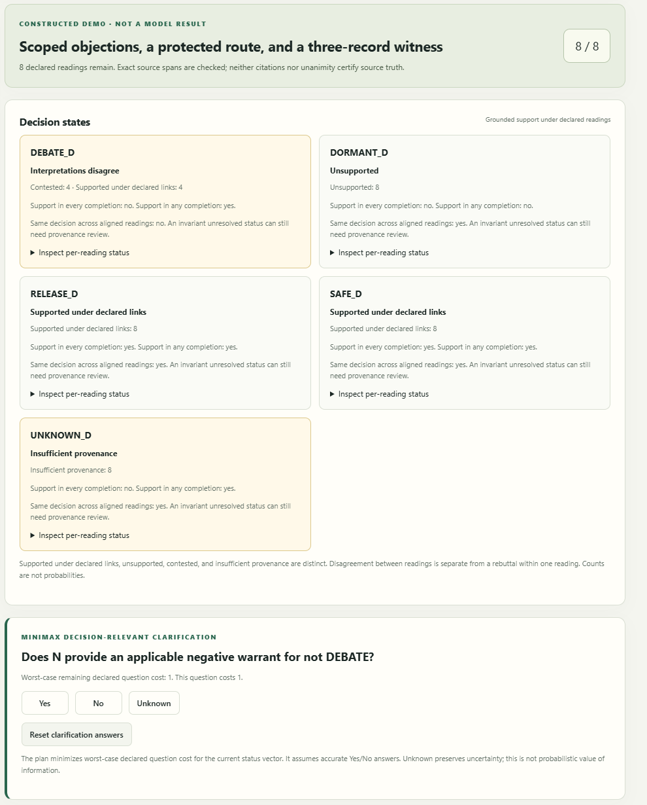
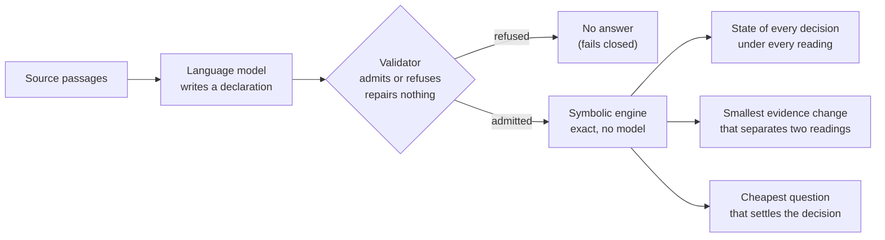
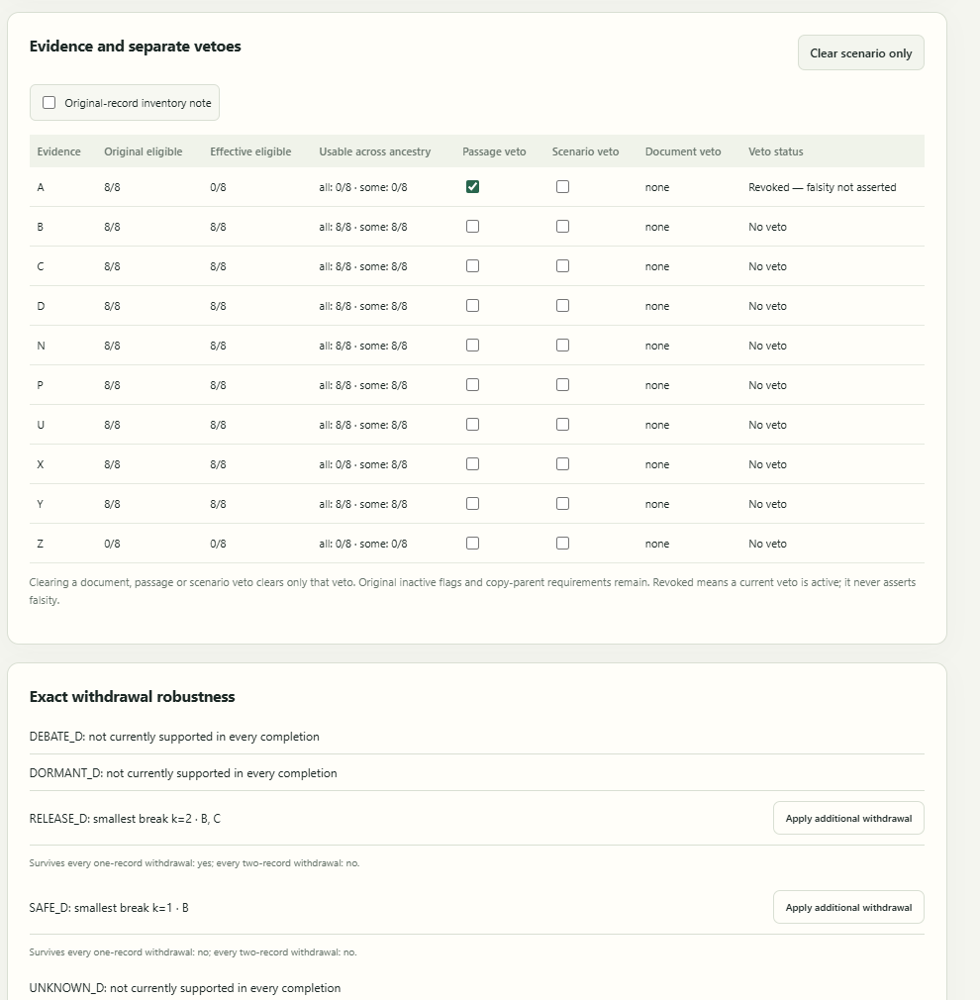
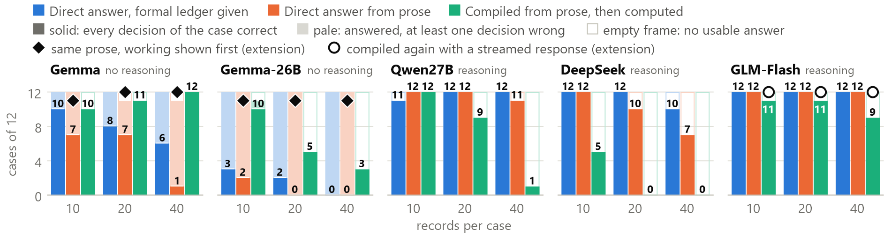
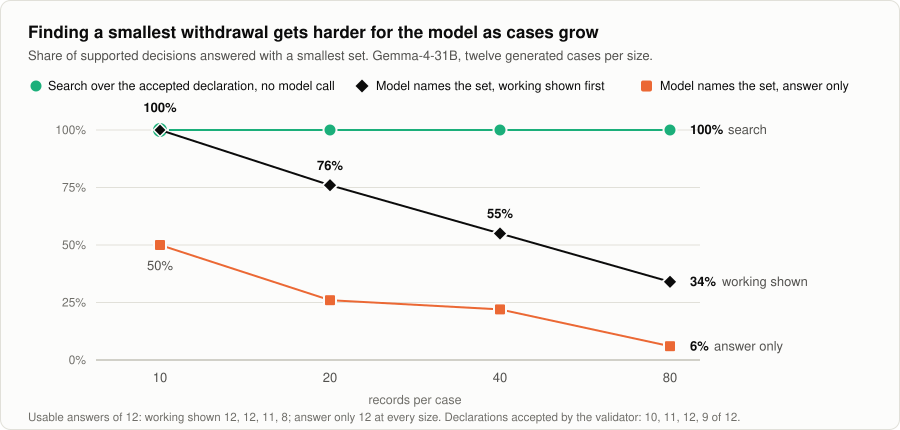

<h1 align="center">RETRACE</h1>

<p align="center">
  <b>Making interpretation differences consequential</b><br>
  Two readers can agree on a decision and still read the evidence differently.<br>
  RETRACE finds the evidence change that makes the difference matter, and the question that settles it.
</p>

<p align="center">
  <a href="docs/RETRACE_paper.pdf"><b>Paper (PDF)</b></a> ·
  <a href="#run-the-workbench">Run the workbench</a> ·
  <a href="#what-we-found">What we found</a> ·
  <a href="#reproduce-the-numbers">Reproduce the numbers</a> ·
  <a href="#limits">Limits</a>
</p>

<p align="center">
  
</p>

<p align="center"><sub>The workbench on its built-in example: every decision under every declared reading, and the one question worth asking. It runs locally and calls no model.</sub></p>

---

## The problem in one example

Two reviewers read the same rule. One takes it to permit a release when record **P** is available. The other takes it to need **P and a second record Q**. P is currently on hold, so both say "do not release". They agree, and they keep agreeing however many records are withdrawn.

| What changes | Reading G: P suffices | Reading H: P and Q | Is a question worth asking? |
|---|---|---|---|
| Nothing (P is on hold) | not supported | not supported | no |
| Q is withdrawn | not supported | not supported | no |
| The hold on P is lifted | supported | supported | no |
| **The hold is lifted and Q is withdrawn** | **supported** | **not supported** | **yes: "does release also need Q?"** |

Agreement today says nothing about agreement after the evidence changes. RETRACE makes that visible before it matters: it searches for the smallest change that separates the readings, and plans the cheapest question that settles the decision.

## How it works



1. **A model only proposes.** It writes a typed declaration: the records, which records are copies of which, what each claim needs, and where the source can be read in more than one way.
2. **A validator admits or refuses the declaration whole.** Nothing is repaired and nothing is applied automatically.
3. **A deterministic engine does the rest.** It recomputes every decision under every declared reading after a withdrawal, searches for the smallest change that makes two readings differ, and plans which question to ask first.

The paper proves four properties of these checks. One of them: finding a smallest separating withdrawal is NP-hard, while checking a proposed one takes a single evaluation per reading. That is why the search belongs to a program and not to a prompt.

## Run the workbench

Python 3.11 or later, standard library only. No API key, no model call, no installation.

```bash
git clone https://github.com/Chrislysen/retrace-ai-epistemics-sprint.git
cd retrace-ai-epistemics-sprint
python -B -S -m retrace.server_v6h --port 8769
```

Open <http://127.0.0.1:8769> and click **Load constructed demo**. Then try three things:

- read the decision cards: one of them says the readings disagree;
- answer the question in the green box with Yes or No and watch that decision settle;
- under "Exact withdrawal robustness", apply a withdrawal and watch a supported decision lose its support.

<p align="center">
  
</p>

On Windows, `START-V6.ps1` does the same. The server listens on your own machine only.

## What we found

This is a sprint project, and the results are reported as they fell, including the ones that did not favour the tool.

**1. The checks fail closed.** In a frozen study of 1,800 scheduled model calls (60 authored cases, five models), every one of the 181 declarations that the validator admitted on the primary route was exactly the authored one. The other 119 scheduled slots produced no admitted declaration: 86 requests returned no answer, 4 answers were cut off and 29 outputs were rejected. Wrong structure did not get through, and missing structure was not invented.

**2. On small cases, models did not need the engine to get the verdict right.** Four of five models matched the authored support verdict on every decision they answered. What the tool adds there is refusal and an audit trail, not accuracy.

**3. On larger cases, answering alone fails, and writing the structure out fixes it.** In a prespecified scaling run (10 to 40 records per case), two models without a reasoning phase got 41 of 270 and 102 of 288 decisions wrong when they had to answer directly. Asked to show their working first, they got 0 of 282 and 4 of 288 wrong. Compiling a declaration and computing from it was about as accurate when the declaration was accepted, and models that reason before answering made no such errors. So compilation is one of three ways to remove the errors, not the only one.

<p align="center">
  
</p>

**4. Where the engine does what models did not: search.** Asked for a smallest further withdrawal that leaves a decision without support, the stronger model found one less and less often as cases grew, even with its working shown. Exhaustive search over the same model's accepted declarations found one every time, with no further model call.

<p align="center">
  
</p>

| Records per case | 10 | 20 | 40 | 80 |
|---|---|---|---|---|
| Search over the accepted declaration | 26 of 26 | 36 of 36 | 60 of 60 | 67 of 67 |
| Model names the set, working shown first | 30 of 30 | 29 of 38 | 29 of 53 | 21 of 62 |
| Model names the set, answer only | 15 of 30 | 10 of 38 | 13 of 60 | 6 of 93 |

**5. A second run changed almost nothing.** Repeating all 216 requests of the two models changed 14 of 1,456 decisions.

## Limits

These are in the paper and they matter.

- **No natural documents and no human annotators.** Every case is authored or generated from sentence templates. Whether a declaration says what a real source says is the open question, and the engine cannot answer it.
- **The engine checks form and consequences, not truth.** Five of the 235 declarations accepted in the scaling run got availability wrong (they confused withdrawn records with records that were never available). Two of the five led to unsafe decisions. The validator could not see it.
- **The search result is partly true by construction.** Once a declaration is accepted and exact, exhaustive search is right. What the run measures is how far naming by a model falls short of that, and that it falls short more as cases grow. The models' oversized sets were mostly padded, not misdirected.
- **Many answers never arrived.** About a sixth of the frozen study's slots failed at the provider, and reasoning models often ran out of output while compiling.
- **Small and narrow.** Twelve cases per cell, two models of one family carry the failure finding, one provider.

## Reproduce the numbers

Everything in Section 4.5 and Appendix H of the paper (the scaling run and its extension) can be recomputed from this repository. The requests and answers are stored as sent and received, one line per request.

```bash
python -X utf8 -B post_sweep/score_scale.py              # main run: four models, 36 cases
python -X utf8 -B post_sweep/score_scale_ext.py          # extension: second model, visible working, copy share, 80 records, second run
python -X utf8 -B post_sweep/score_withdrawal_task.py    # the search task
python -X utf8 -B post_sweep/check_withdrawal_reference.py   # the same question recomputed with the project's own engine
python -X utf8 -B paper_build/scale_paper_numbers.py     # every number and table the paper quotes
```

The rules of each test were written and committed before its first model call. They are in [`prereg/`](prereg), with their SHA-256 values in [`prereg/HASHES`](prereg/HASHES). Expectations that failed are reported as failed.

## What is in this repository

| Path | What it holds |
|---|---|
| [`retrace/`](retrace) | The engine, the validator and the local server. Standard library only. |
| [`web/`](web) | The workbench front end. |
| [`scripts/`](scripts), [`tests/`](tests) | The pipeline of the frozen study and its tests. Parts of these need the frozen corpus, which is not in this repository (see below). |
| [`prereg/`](prereg) | Analysis rules, fixed before the data they govern existed. |
| [`post_sweep/`](post_sweep) | The independent recomputation, the scaling run and its extension: generators, runners, scorers, and the request and response journals. |
| [`paper_build/`](paper_build) | The tables and figures of the paper and the scripts that produce them. |
| [`docs/`](docs) | The paper and the pictures on this page. |

### What is not here

The frozen corpus of the 1,800-slot study, its raw model outputs and the captured source documents are not in this repository. Twelve of its 60 cases are built on excerpts of third-party publications, and their redistribution has not been cleared (see [`SOURCE-NOTICES-V6.md`](SOURCE-NOTICES-V6.md)). The complete archive exists as one file (SHA-256 `afc3ad9241a5d28d5a48bff65dfd1e6c6c9c46f1a3ae5c85c29e6087dcaebefe`, the value given in the paper) and is available from the author for review.

## The paper

**RETRACE: Making Interpretation Differences Consequential.** Christian Lysenstøen. AI x Epistemics Research Sprint, Apart Research, November 2026. [Read the PDF](docs/RETRACE_paper.pdf).

No project source file existed before the sprint began on 13 November 2026. The code, cases, interface and experiments were produced during the sprint with AI assistance, which Appendix F of the paper describes in detail.

No license has been chosen yet. Until one is added, the code is published for reading and review. Third-party material keeps its own terms, as listed in the source notices.
